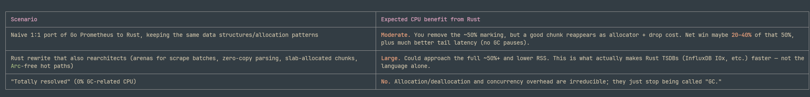

prometheus cpu
==============

https://github.com/prometheus/prometheus/issues/16331

https://www.youtube.com/watch?v=IWrd-pSojqg

Check if compaction is wroking? with 12hr retention, it shouldnt, becvausw 10% limit

Moving to 1hr block instead of 2 hours -> slightly less cpu, query CPU increases, disk after flush increases

WAL size is equal to min block duration, WAL has uncompressed data

suppose I have an app which runs queries every 2 minutes, It sums data on last 1 hour. Now, if I migrate from 2h to 1 hr blocks, will it have an impact?
Yes, if query runs on last 1 hour, there will be a mismatch and it lods the block everytime from disk to memory
Storage Boundary Crossings Drop to 50% (on 1-Hour Blocks) - If query runs on last 30 mins

reducing the minimum block duration from 2 hours to 1 hour will directly lower your baseline Garbage Collection (GC) CPU consumption.

The Live Heap Scan: The CPU overhead of Go's garbage collector is heavily dependent on the size of the "live heap" (the active objects currently held in memory). During every GC cycle, the runtime must scan all of these live objects.The Head Block Footprint: In Prometheus, the largest contributor to the live heap is the in-memory Head block, which stores the indexing structures, label pairs, and active series pointers for the most recent data.The 50% Reduction: With the default 2-hour setting, the Head block holds between 2 to 3 hours of active data before truncating. By reducing the block duration to 1 hour, the Head block only holds 1 to 2 hours of data, effectively cutting its active memory footprint by roughly 50%.   The GC CPU Result: Because the memory footprint is halved, the Go runtime has significantly fewer live objects to scan during its mark phase. This directly reduces the CPU cycles spent continually traversing the heap.

 Heavy marking CPU usually means high allocation rate + large live heap, not "GC is broken."
 
 2. Tune GC: set GOMEMLIMIT (Go 1.19+) to ~80–90% of container memory limit, and raise GOGC (e.g. 200–400) to trade memory for CPU. This alone often halves marking CPU.

2. Profile to see if allocations are in promql vs tsdb (cardinality).

# Compaction

- HEad compac