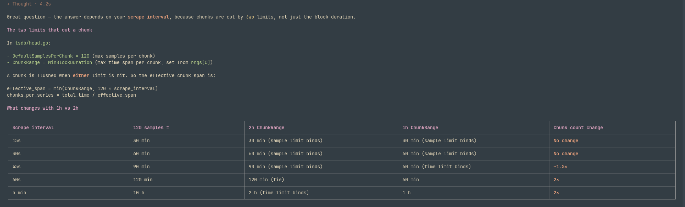

prometheus cpu
==============

https://github.com/prometheus/prometheus/issues/16331

https://www.youtube.com/watch?v=IWrd-pSojqg

Check if compaction is wroking? with 12hr retention, it shouldnt, becvausw 10% limit

Moving to 1hr block instead of 2 hours -> slightly less cpu, query CPU increases, disk after flush increases

WAL size is equal to min block duration, WAL has uncompressed data

suppose I have an app which runs queries every 2 minutes, It sums data on last 1 hour. Now, if I migrate from 2h to 1 hr blocks, will it have an impact?
Yes, if query runs on last 1 hour, there will be a mismatch and it lods the block everytime from disk to memory
Storage Boundary Crossings Drop to 50% (on 1-Hour Blocks) - If query runs on last 30 mins

reducing the minimum block duration from 2 hours to 1 hour will directly lower your baseline Garbage Collection (GC) CPU consumption.

The Live Heap Scan: The CPU overhead of Go's garbage collector is heavily dependent on the size of the "live heap" (the active objects currently held in memory). During every GC cycle, the runtime must scan all of these live objects.The Head Block Footprint: In Prometheus, the largest contributor to the live heap is the in-memory Head block, which stores the indexing structures, label pairs, and active series pointers for the most recent data.The 50% Reduction: With the default 2-hour setting, the Head block holds between 2 to 3 hours of active data before truncating. By reducing the block duration to 1 hour, the Head block only holds 1 to 2 hours of data, effectively cutting its active memory footprint by roughly 50%.   The GC CPU Result: Because the memory footprint is halved, the Go runtime has significantly fewer live objects to scan during its mark phase. This directly reduces the CPU cycles spent continually traversing the heap.

 Heavy marking CPU usually means high allocation rate + large live heap, not "GC is broken."
 
 2. Tune GC: set GOMEMLIMIT (Go 1.19+) to ~80–90% of container memory limit, and raise GOGC (e.g. 200–400) to trade memory for CPU. This alone often halves marking CPU.

2. Profile to see if allocations are in promql vs tsdb (cardinality).

# Compaction

- Head compaction: 2hr blocks
- OOO compaction: compaction of out of order samples
- Levelled blocks: ,  multiplies by 3 each level, 10 levels: for 2h → 2h, 6h, 18h, 54h, 162h, 486h, 
- Vertical compaction: FOr overlapping blocks

WAL truncation: happens after head compaction

// clear head block sooner
--storage.tsdb.min-block-duration=1h

// disable larger compactions
--storage.tsdb.max-block-duration=1h

Prometheus does not send remote write data to a backend like Cortex on a single, fixed interval. Instead, it streams data continuously in near real-time batches, governed by two main triggers.

Behind the scenes, Prometheus reads scraped metrics from its local Write-Ahead Log (WAL), groups them into memory buffers (called shards), and sends an HTTP POST request to 
Cortex whenever one of the following two thresholds is met:

Batch Size Limit (max_samples_per_send): 
If a shard collects enough samples to hit this limit (default is typically 2,000 samples), it sends the batch immediately, regardless of how much time has passed. 
High-volume Prometheus servers hit this limit constantly, resulting in multiple sends per second.   

Time Limit (batch_send_deadline): If the shard hasn't reached the sample limit but this time deadline is reached (default is usually 5 seconds), it sends whatever data it has. 
This ensures low-volume metrics aren't delayed just waiting for a batch to fill up.

If Cortex slows down or becomes briefly unavailable, Prometheus does not immediately drop the data.   It uses an exponential backoff strategy for retries.   It continues to buffer unsent data in its local WAL.   

# Chunks
- head chunks: mmpaed ,  in RAM  (chunks_head/)
- block chunks: in storage, disk  (<block>/chunks/)

120 samples, 2 hr chunk flush. On 1hr head block,  chunk compaction happens

Tets scenario where if head chunk count doubles
